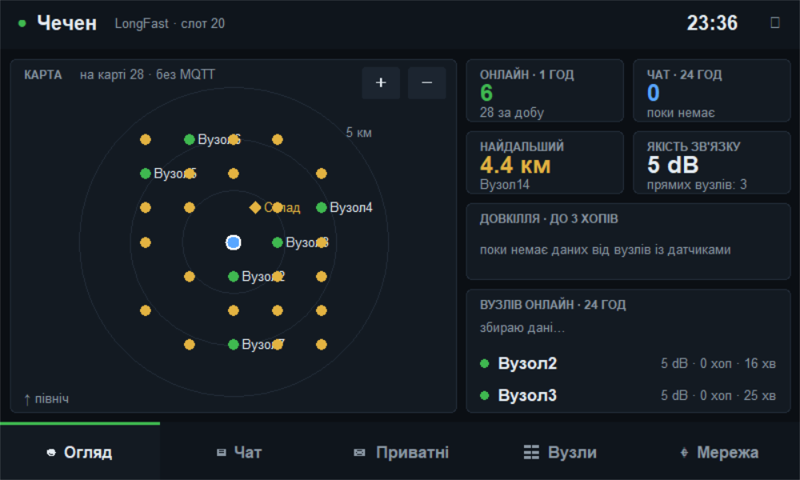
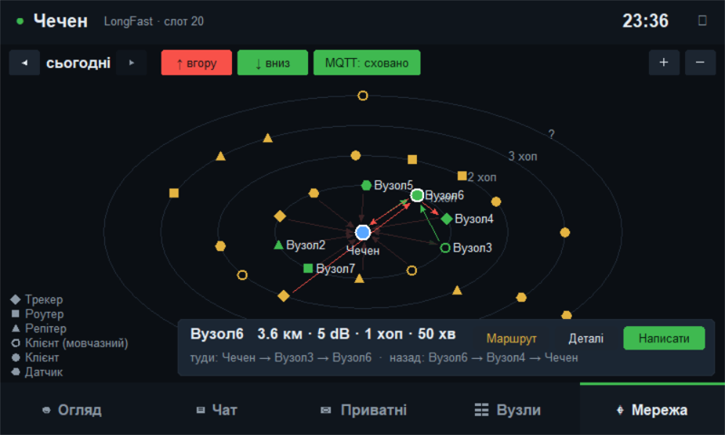
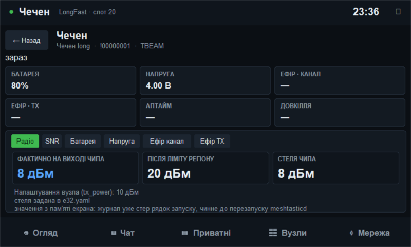
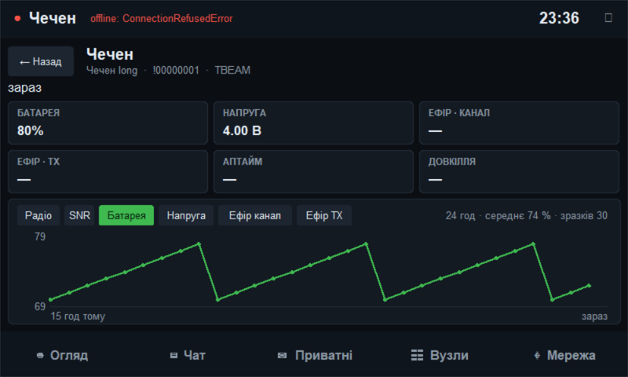
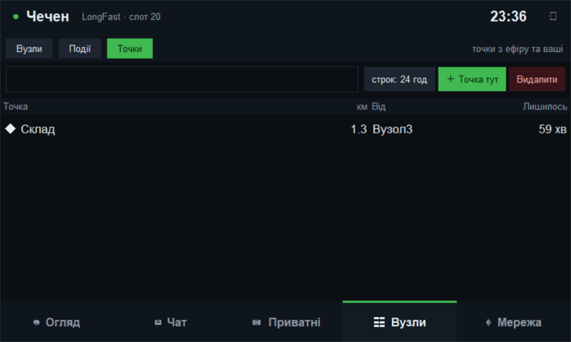
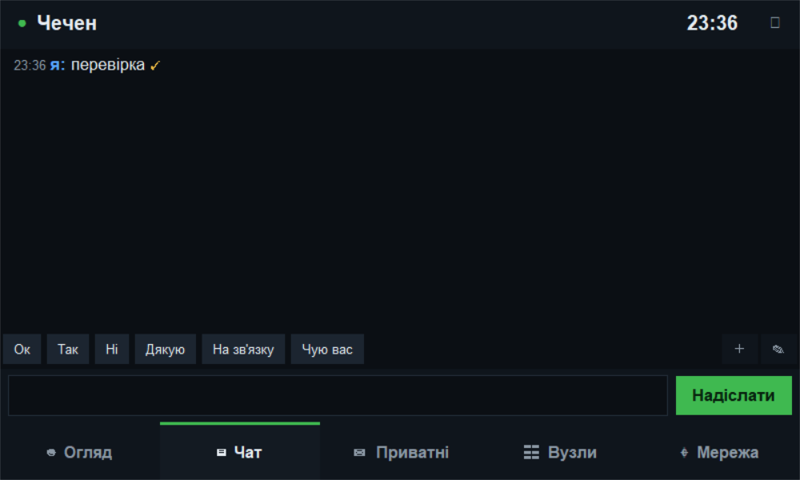

# mesh-screen

Сенсорний застосунок для Meshtastic-вузла на Raspberry Pi з екраном 800×480: чат, приватні розмови, вузли, карта,
мапа маршрутів мережі, радіо-потужність, телеметрія, точки на карті. Один файл `mesh-screen.py` на Tkinter, жодного
сервера й браузера. Розмова з вузлом іде через TCP API `meshtasticd` (порт 4403, зазвичай через `mesh-proxy`, щоб екран,
телефон і бот ділили один вузол).

Це «малий брат» веб-панелі [Meshpi](https://github.com/denisraychenko/meshpi): ті самі ідеї (кола хопів, ролі,
стрілки вгору/вниз, точки, статус доставки), але для екрана на самій платі.



## Що вміє

| Вкладка | Можливості |
|---|---|
| **Огляд** | карта навколо вузла з кільцями відстані, точки (◆), картки: хто онлайн, найдальший, якість зв'язку, довкілля до 3 хопів, графік вузлів за добу |
| **Чат** | канал LongFast, звук, швидкі відповіді (**＋** зберігає набране, **✎** вмикає видалення), екранна клавіатура UA/EN |
| **Приватні** | розмова з кожним вузлом, непрочитані |
| **Вузли** | список, фільтри, **MQTT: сховано/показано**, журнал подій (нові вузли, обрані що пропали), **Точки** (waypoints) |
| **Мережа** | вузли на колах за хопами, значки за роллю, стрілки вгору (червоні) і вниз (зелені), архів по днях, traceroute «Маршрут» |
| **Вузол** (дотик по вузлу) | графіки за добу: SNR, батарея, напруга, ефір; для свого вузла вкладка **Радіо** |



### Мережа

Зв'язки екран вчить сам, нічого не надсилаючи в ефір: з кожного пакета видно, хто його ретранслював (останній байт id),
NeighborInfo дає сусідів, відповідь traceroute дає повний шлях туди й назад. Червоні стрілки це «вгору» (як чують нас),
зелені «вниз» (як чують наші пакети), пунктир означає шлях через ретранслятор. Торкніться вузла: SNR, хопи, шлях
traceroute і кнопки «Маршрут», «Деталі», «Написати». Traceroute це передача в ефір, тому запити йдуть по одному й не
частіше ніж раз на 45 с. Автоматичного traceroute по колу немає.

### Радіо (лише читання)



Для свого вузла вкладка **Радіо** показує те, чого немає в налаштуваннях: «фактично на виході чипа»
(`Final Tx power` у журналі `meshtasticd`), потужність після ліміту регіону (`Set radio`) і стелю чипа з
`/etc/meshtasticd/*.yaml`. Нічого не змінюється: читається лише журнал і конфіги. Рядок `Set radio` зникає з журналу в
пам'яті за кілька годин, тому останнє значення запам'ятовується у `~/.config/mesh-screen/radio.json` до перезапуску
`meshtasticd`. Якщо в журналі нічого немає, показується налаштування вузла з позначкою «≈» (це оцінка). Для читання
журналу користувач має бути в групі `adm` або `systemd-journal`.

### Телеметрія, точки, доставка



- Графіки батареї, напруги й зайнятості ефіру збираються з пакетів телеметрії від моменту запуску (вузли шлють їх приблизно раз на пів години).
- **Точки**: чужі з'являються самі (і на карті «Огляд»), свою ставить кнопка «＋ Точка тут» у позиції вузла, видалити можна лише свою.
- **Доставка**: повідомлення йдуть із підтвердженням. ⏳ очікує, ✓ прийняв сусід, ✓✓ підтвердив сам адресат, ✗ не доставлено (причина у верхньому рядку).

 

## Вимоги

- Raspberry Pi з екраном, робочий стіл (X11/Wayland із `DISPLAY=:0`), `python3-tk`.
- `meshtasticd` або будь-який Meshtastic-вузол із TCP API, дефолт `127.0.0.1:4403` (`MESH_HOST`, `MESH_PORT`).
- Віртуальне середовище з `meshtastic` (тягне `pypubsub`): `python3 -m venv ~/mesh-bridge-venv && ~/mesh-bridge-venv/bin/pip install meshtastic`.
- Необов'язково: `mesh-logger` (історія повідомлень і SNR вузлів у тій самій SQLite). Без нього екран пише сам усе, крім історії до свого запуску.

## Встановлення

```bash
# на Pi, у домашній теці: три файли поруч (mesh_env.py і mesh_extra.py обов'язкові)
scp mesh-screen.py mesh_extra.py mesh_env.py mesh-screen-autostart.sh pi@<адреса>:~/
ssh pi@<адреса> 'bash ~/mesh-screen-autostart.sh'     # автозапуск з перезапуском після збою
# кнопка «Живлення» (вимкнути / перезавантажити Pi) без пароля, один раз:
scp mesh-power-install.sh pi@<адреса>:~/ && ssh -t pi@<адреса> 'sudo bash ~/mesh-power-install.sh'
```

Оновлення: скопіювати файли й `pkill -f '[b]in/python .*mesh-screen.py'` (автозапуск підніме нову версію).
Не користуйтеся `pkill -f mesh-screen.py` усередині `ssh "..."`: шаблон збігається з рядком самої команди й обриває сесію.

## Налаштування

| Що | Де |
|---|---|
| Адреса вузла | змінні `MESH_HOST`, `MESH_PORT` |
| База | `MESH_DB` (типово `~/.local/share/mesh/messages.db`) |
| Обрані вузли, швидкі відповіді, MQTT-фільтр | `~/.config/mesh-screen/settings.json` (записується атомарно) |
| Запам'ятована потужність радіо | `~/.config/mesh-screen/radio.json` |
| Демо для скриншотів | `MESH_DEMO=node|events|env|nodes|menu|fav` |

## Тести

Без вузла й мережі, лише стандартна бібліотека:

```bash
python tests/test_mesh_env.py
python tests/test_mesh_extra.py
```

Перегляд інтерфейсу з вигаданими даними (потрібні Tk, дисплей і пакет `meshtastic`; `Pillow` для скриншотів):

```bash
python tests/test_mesh_screen_ui.py                  # малює всі сторінки, перевіряє логіку
SHOT_DIR=out python tests/test_mesh_screen_ui.py     # плюс PNG 800×480
```

## Безпека

Екран нічого не змінює в налаштуваннях вузла: радіо, регіон, потужність і ключі він лише читає чи взагалі не торкається.
Він надсилає тільки те, що ви самі вводите: повідомлення, точки й traceroute. Повідомлення йдуть із підтвердженням
доставки (`wantAck`), як у застосунку Meshtastic, тому в ефірі їх трохи більше.

## Ліцензія

Ліцензію додайте на власний розсуд (файл `LICENSE`); без неї за замовчуванням усі права збережені за автором.
